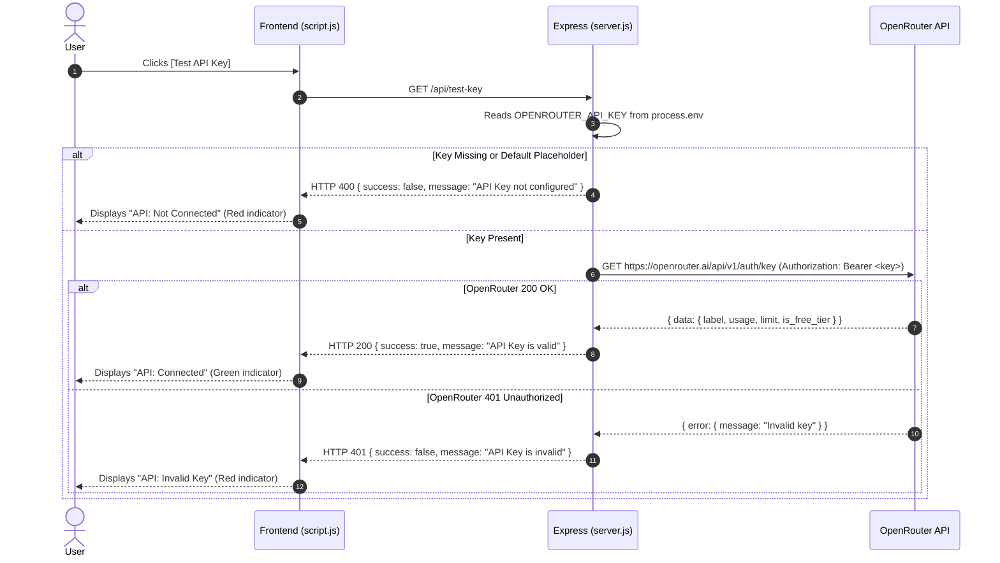
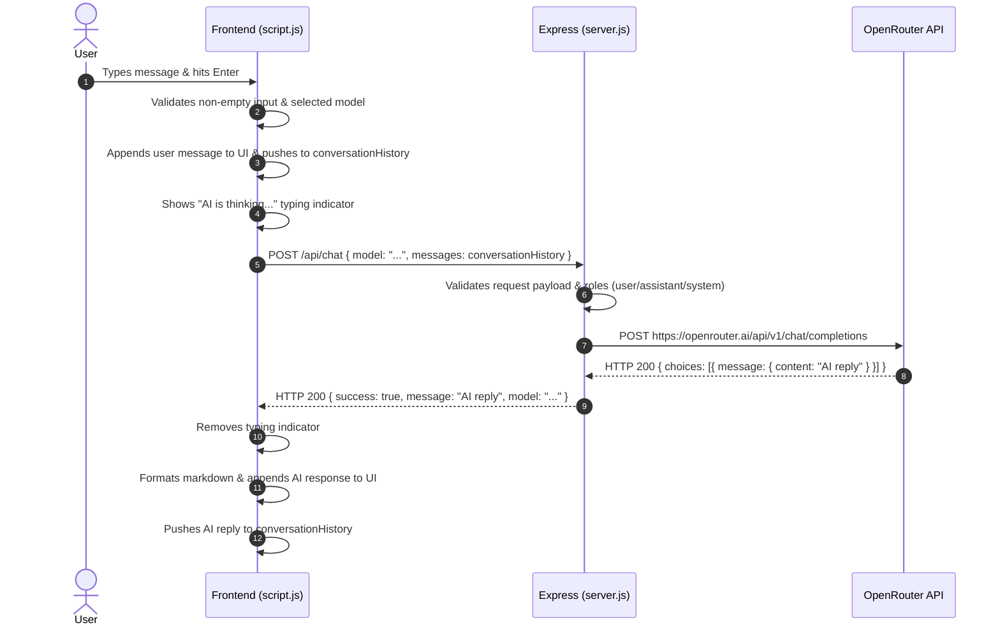

# 🤖 Intermediate AI Chatbot (OpenRouter + Express + Vanilla JS)

A clean, intermediate-level AI chatbot web application powered by **Node.js**, **Express**, and the **OpenRouter API**. Designed for Computer Science and Engineering (CSE) students, full-stack developers, and portfolio demonstrations.

---

## 🔒 Crucial Security Notice: Exposed API Keys

> [!CAUTION]
> **If you have previously shared or exposed an OpenRouter API key in any chat, code snippet, repository, or public forum:**
> 1. **Revoke the exposed key immediately** at [OpenRouter API Keys](https://openrouter.ai/settings/keys).
> 2. Generate a **new, fresh API key**.
> 3. Store that new key exclusively in your local `.env` file (`OPENROUTER_API_KEY=your_new_key_here`).
> 4. Ensure `.env` is listed inside `.gitignore` so it is never committed to GitHub.
> 5. Never paste or reference your API key in frontend code, HTML, CSS, client JS, or browser `localStorage`.
> 
> **Architecture Flow:**  
> `Browser (Frontend)` ➔ `Local Backend (Express.js)` ➔ `OpenRouter API` ➔ `Local Backend` ➔ `Browser (Frontend)`  
> *The browser NEVER communicates directly with OpenRouter and NEVER sees the API key.*

---

## 📋 Table of Contents

1. [Project Overview](#-project-overview)
2. [Key Features](#-key-features)
3. [Technologies Used](#-technologies-used)
4. [Project Structure](#-project-structure)
5. [Installation & Setup](#-installation--setup)
6. [Creating Your OpenRouter API Key](#-creating-your-openrouter-api-key)
7. [Configuring Environment Variables](#-configuring-environment-variables)
8. [Running the Application](#-running-the-application)
9. [How It Works](#-how-it-works)
   - [API Key Validation Flow](#1-api-key-validation-flow)
   - [Dynamic Model Discovery Flow](#2-dynamic-model-discovery-flow)
   - [Model Selection Flow](#3-model-selection-flow)
   - [Chat Request & Conversation Memory Flow](#4-chat-request--conversation-memory-flow)
10. [Step-by-Step Testing & Demonstration Guide](#-step-by-step-testing--demonstration-guide)
11. [Troubleshooting & Common Errors](#-troubleshooting--common-errors)
12. [Security Best Practices](#-security-best-practices)

---

## 🌟 Project Overview

This project implements an intermediate-level chatbot interface that connects directly to OpenRouter's extensive catalog of AI models (including models from OpenAI, Google Gemini, Anthropic Claude, DeepSeek, Meta Llama, and Mistral).

It avoids excessive enterprise boilerplate (no Docker, no database, no authentication, no complex frameworks) while adhering strictly to modern web engineering patterns:
- Decoupled client-server architecture
- Secure server-side credential isolation
- RESTful JSON API endpoints
- Safe HTML escaping and markdown formatting
- Session-based conversation memory

---

## ⚡ Key Features

- **Live OpenRouter Model Discovery:** Automatically queries `GET https://openrouter.ai/api/v1/models` and organizes them into provider groups (`OpenAI`, `Google`, `Anthropic`, `DeepSeek`, `Meta`, `Mistral`, `Other`).
- **Interactive Model Information Panel:** Displays the selected model's context window (e.g. `128K`, `1M`), token pricing (prompt and completion rates per 1M tokens), and free/paid indicators.
- **API Key Health Verification:** Frontend button `[Test API Key]` triggers backend endpoint `GET /api/test-key` to test key validity without exposing secret strings.
- **Multi-Turn Session Memory:** Maintains conversational context during the active session so the AI remembers previous exchanges.
- **One-Click Conversation Reset:** `[Clear Chat]` button clears in-memory history and returns the UI to its clean initial state.
- **Smart Loading States:** Displays `"AI is thinking..."` with animated bouncing dots and disables input during generation to prevent race conditions.
- **Keyboard Shortcuts:** `Enter` sends the message; `Shift + Enter` inserts a newline.
- **Code Block Formatting & Clipboard:** Formats code fences with syntax styling and an instant `Copy` button.
- **Responsive Modern Dark Theme:** Designed using CSS custom properties, responsive flexbox/grid, and mobile-friendly layouts.

---

## 🛠 Technologies Used

### Frontend
- **HTML5:** Semantic document structure with accessible form controls and ARIA labels.
- **CSS3:** Modern design system featuring dark mode, CSS custom properties (`var(--...)`), animations, and media queries.
- **Vanilla JavaScript (ES6+):** Pure browser JavaScript with `Fetch API`, DOM manipulation, event delegation, and state management.

### Backend
- **Node.js (v18+):** High-performance JavaScript runtime environment.
- **Express.js (v4):** Minimalist web framework for routing and static asset serving.
- **dotenv:** Loads environment variables safely from `.env`.
- **cors:** Handles cross-origin requests for local development flexibility.

### AI Gateway
- **OpenRouter API (`https://openrouter.ai/api/v1`):** Unified REST API for querying completions and discovering models.

---

## 📁 Project Structure

```text
ai-chatbot/
│
├── backend/
│   ├── server.js          # Core Express server & OpenRouter API routes
│   └── package.json       # Backend configuration
│
├── public/                # Static frontend assets served by Express
│   ├── index.html         # Modern semantic chatbot interface
│   ├── style.css          # Tech dark-theme responsive stylesheet
│   └── script.js          # Client-side state, API calls & markdown rendering
│
├── .env                   # Local secrets file (IGNORED BY GIT)
├── .env.example           # Example environment template
├── .gitignore             # Git ignore file protecting .env & node_modules
├── package.json           # Root project metadata & npm scripts
├── server.js              # Root server entrypoint
└── README.md              # Complete documentation and testing guide
```

---

## 🚀 Installation & Setup

### Prerequisites
Make sure you have **Node.js** (version 18 or newer) installed on your system. Verify by running:

```bash
node -v
npm -v
```

### Step 1: Clone or Navigate to the Project Directory
```bash
cd ai-chatbot
```

### Step 2: Install Node Dependencies
```bash
npm install
```
*(This installs `express`, `dotenv`, and `cors`.)*

---

## 🔑 Creating Your OpenRouter API Key

1. Navigate to [https://openrouter.ai/](https://openrouter.ai/) and sign up or log in.
2. Go to your account settings: [https://openrouter.ai/settings/keys](https://openrouter.ai/settings/keys).
3. Click **"Create Key"**.
4. Give your key a name (e.g. `CSE-Chatbot-Demo`).
5. Copy the newly generated key string (`sk-or-v1-...`).

> [!IMPORTANT]
> If you choose to use paid models (e.g., `openai/gpt-4o`, `anthropic/claude-3.5-sonnet`), ensure you have credits on OpenRouter. Alternatively, OpenRouter provides many **100% free models** (e.g., models ending with `:free`, like `google/gemini-2.0-flash-exp:free` or `meta-llama/llama-3.1-8b-instruct:free`).

---

## ⚙️ Configuring Environment Variables

1. In the project root (`ai-chatbot/`), create a file named `.env` (or copy `.env.example`):

```bash
# On Windows PowerShell:
Copy-Item .env.example .env

# On macOS/Linux:
cp .env.example .env
```

2. Open `.env` in your text editor and paste your OpenRouter key:

```ini
OPENROUTER_API_KEY=sk-or-v1-your-actual-openrouter-key-here
PORT=3000
```

3. Save the file.

---

## ▶️ Running the Application

Start the backend server using either of the following commands:

```bash
npm start
```
*or directly with Node:*
```bash
node server.js
```

You should see console output similar to:
```text
========================================================
🚀 OpenRouter AI Chatbot Server running on: http://localhost:3000
📁 Serving frontend from: .../ai-chatbot/public
🔑 OpenRouter Key configured: YES (Hidden)
========================================================
```

Open your browser and navigate to:
```text
http://localhost:3000
```

---

## 🧠 How It Works

### 1. API Key Validation Flow



### 2. Dynamic Model Discovery Flow

```mermaid
sequenceDiagram
    autonumber
    participant Browser as Frontend (script.js)
    participant Server as Express (server.js)
    participant OpenRouter as OpenRouter API

    Browser->>Server: GET /api/models
    Server->>OpenRouter: GET https://openrouter.ai/api/v1/models
    OpenRouter-->>Server: JSON list of all available models
    Server->>Server: Parses models, calculates 1M token prices, groups by provider
    Server-->>Browser: { success: true, models: [...] }
    Browser->>Browser: Populates <select> dropdown with <optgroup> categories
    Browser->>Browser: Selects default model & updates Model Info Banner
```



### 3. Model Selection Flow

1. User clicks the **Model** dropdown.
2. User selects an option (e.g., `Google — Gemini 2.5 Flash`).
3. Frontend triggers `change` event, saving `selectedModelId = "google/gemini-2.5-flash"` into `state`.
4. The **Model Information Banner** updates instantly, displaying the model's provider, context length, and input/output token pricing.

### 4. Chat Request & Conversation Memory Flow



---

## 🧪 Step-by-Step Testing & Demonstration Guide

Here is a verification checklist designed for evaluating and demonstrating the chatbot:

| Test # | Objective | Action | Expected Result |
| :--- | :--- | :--- | :--- |
| **Test 1** | **Server Startup** | Run `npm start` | Terminal reports `Server running on: http://localhost:3000`. |
| **Test 2** | **API Key Check** | Click `[Test API Key]` | If configured: green dot with `API: Connected`. If placeholder: red dot with `API: Not Connected`. |
| **Test 3** | **Model Discovery** | Inspect dropdown on load | Dropdown is populated with live models grouped by provider (OpenAI, Google, Anthropic, DeepSeek, etc.). |
| **Test 4** | **Model Selection** | Select a different model | The selected model ID is retained in state; Model Info banner reflects new provider, context, and pricing. |
| **Test 5** | **Basic Message** | Send: `"Hello, introduce yourself."` | Send button disables, "AI is thinking..." animates, and the AI reply appears with timestamp. |
| **Test 6** | **Conversation Memory** | 1. Send: `"My name is Alice."`<br>2. Send: `"What is my name?"` | The AI correctly responds: `"Your name is Alice."`, proving multi-turn memory works. |
| **Test 7** | **Empty Message** | Hit Enter on empty textarea | Warning toast appears: `"Please enter a message before sending."` No network request sent. |
| **Test 8** | **API Error Handling** | Set an invalid key in `.env` (`OPENROUTER_API_KEY=sk-or-invalid`) and restart | UI shows friendly error: `"API Key is invalid or expired."` Server remains running safely without crashing. |
| **Test 9** | **Clear Chat** | Click `[Clear Chat]` | UI clears messages, welcome card returns, and internal memory array resets to `[]`. |
| **Test 10** | **Mobile Responsiveness**| Resize browser to 375px width | Header stacks neatly, inputs fit the viewport, and no horizontal scroll appears. |

---

## 🔍 Troubleshooting & Common Errors

### 1. `Cannot find module 'express'`
- **Cause:** Dependencies were not installed.
- **Fix:** Run `npm install` inside the project directory.

### 2. `OpenRouter API key is not configured`
- **Cause:** `.env` file is missing or still contains the placeholder `your_new_key_here`.
- **Fix:** Open `.env` and paste your actual key starting with `sk-or-v1-`. Restart the server.

### 3. `Status 402: Insufficient credits`
- **Cause:** The selected model is a paid model and your OpenRouter account balance is $0.00.
- **Fix:** Select any model labeled `[Free]` from the dropdown (e.g. `google/gemini-2.0-flash-exp:free` or `meta-llama/llama-3.1-8b-instruct:free`), or add credits at [openrouter.ai/credits](https://openrouter.ai/credits).

### 4. `Port 3000 is already in use`
- **Cause:** Another process is listening on port 3000.
- **Fix:** Change `PORT=3001` inside your `.env` file and restart.

---

## 🛡 Security Best Practices

1. **Environment Isolation:** Secrets live exclusively in process environment memory loaded from `.env`.
2. **Git Hygiene:** `.env` is permanently excluded via `.gitignore`.
3. **No Frontend Leaks:** Neither the frontend JavaScript nor any API endpoint returns the API key string.
4. **Input Sanitization:** User messages are escaped against Cross-Site Scripting (XSS) before HTML rendering.
5. **No Stack Trace Leaks:** Server errors are intercepted and translated into human-friendly messages rather than exposing backend system traces.
